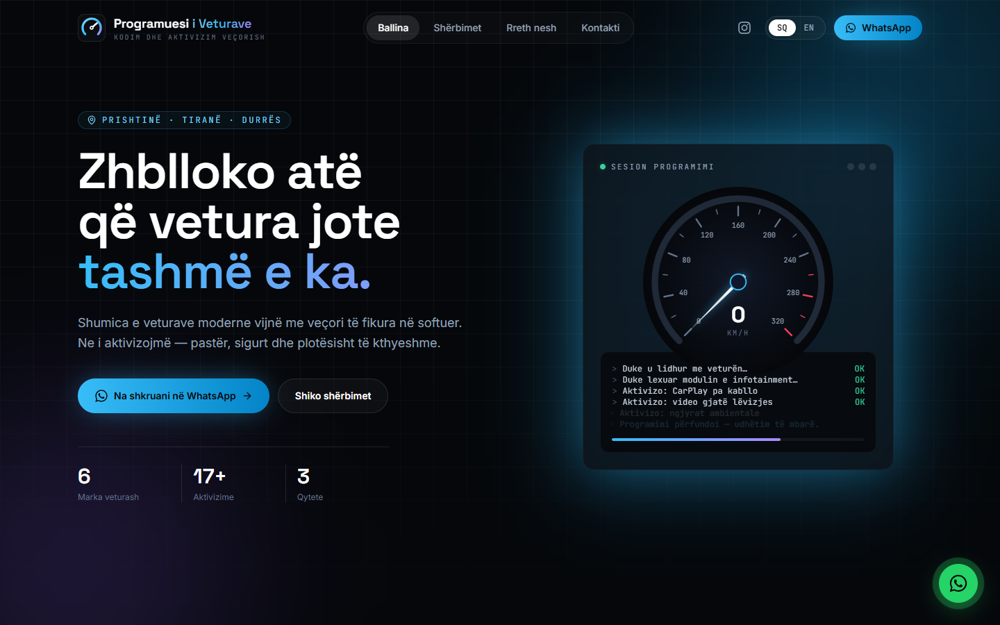
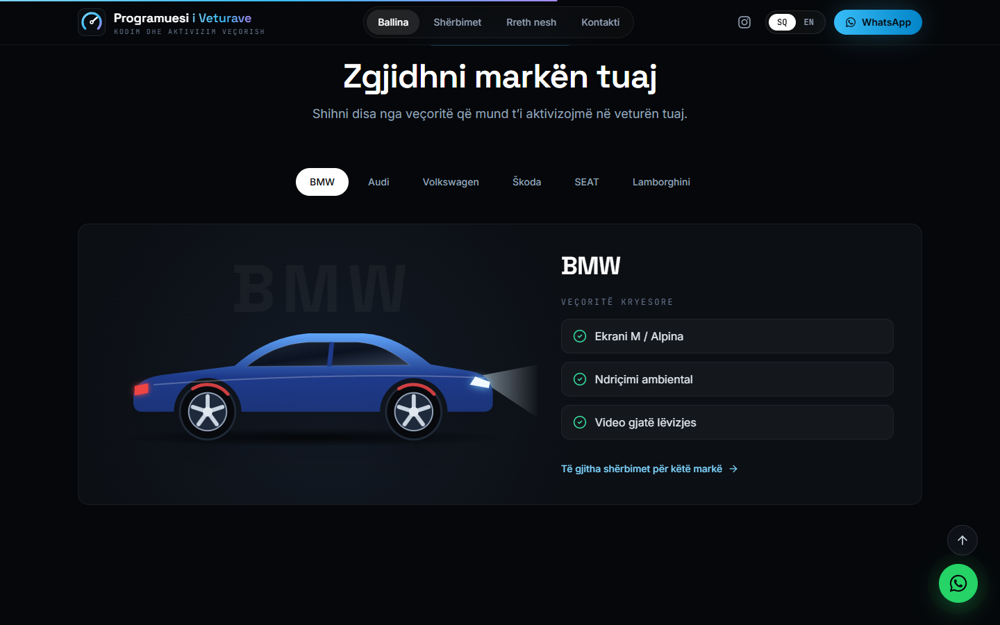
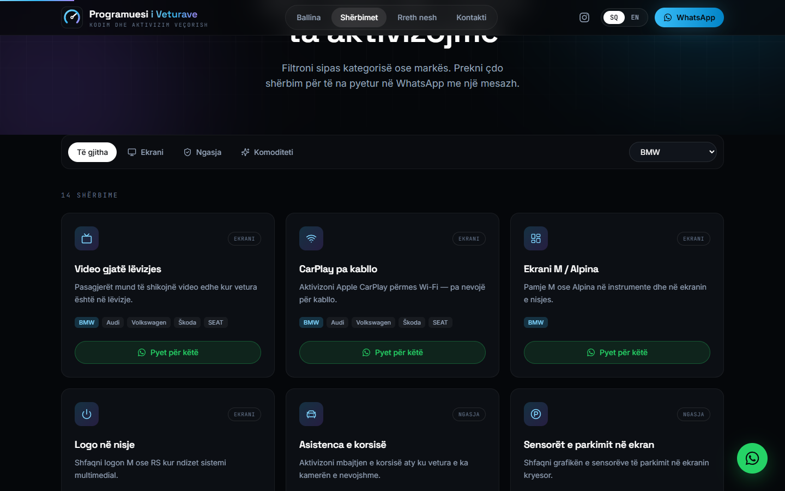
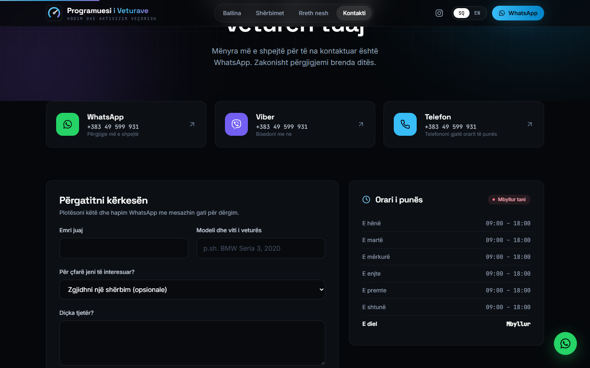
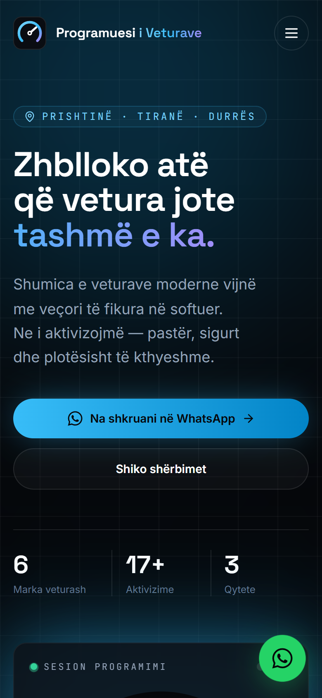

<div align="center">


# Programuesi i Veturave

**Car coding & factory-feature activation — Prishtinë · Tiranë · Durrës**

The official website: a fast, bilingual, animated single-page app built with React, TypeScript and Vite.

[**Live site**](https://programuesiiveturave.netlify.app) ·
[Report a bug](https://github.com/iligashi/programuesi-i-veturave/issues/new?template=bug_report.yml) ·
[Request a feature](https://github.com/iligashi/programuesi-i-veturave/issues/new?template=feature_request.yml)

[](https://github.com/iligashi/programuesi-i-veturave/actions/workflows/ci.yml)
[](https://github.com/iligashi/programuesi-i-veturave/releases)


<br />



</div>

## Contents

- [Highlights](#highlights)
- [Screenshots](#screenshots)
- [Tech stack](#tech-stack)
- [Getting started](#getting-started)
- [Scripts](#scripts)
- [Project structure](#project-structure)
- [Architecture notes](#architecture-notes)
- [Quality](#quality)
- [Deployment](#deployment)
- [Contributing](#contributing)
- [License](#license)

## Highlights

|                            |                                                                                                                                                                                                                                   |
| -------------------------- | --------------------------------------------------------------------------------------------------------------------------------------------------------------------------------------------------------------------------------- |
| 🌍 **Bilingual**           | Albanian (default) and English. The Albanian dictionary is type-checked against the English one, so a missing translation fails the build. The choice is remembered and `<html lang>` follows it.                                 |
| 🎬 **Motion design**       | Live "needle sweep" speedometer and self-typing coding log, scroll-linked parallax, reveal-on-scroll sections, a brand explorer with animated SVG cars and spotlight hover cards — all respecting the OS _reduce motion_ setting. |
| 🔎 **Shareable filters**   | Services can be filtered by category and brand; the filters live in the URL (`/services?brand=bmw`).                                                                                                                              |
| 💬 **One-tap contact**     | `tel:`, WhatsApp and Viber everywhere, a floating WhatsApp button, prefilled messages per service and a request builder that opens WhatsApp — no backend required.                                                                |
| 🕘 **Live opening status** | "Open now / Closed" computed in the business timezone (`Europe/Belgrade`).                                                                                                                                                        |
| 📈 **SEO ready**           | Per-page titles and descriptions, canonical URLs, Open Graph image, `AutoRepair` structured data, sitemap and robots.txt.                                                                                                         |
| ♿ **Accessible**          | Skip link, labelled icon buttons, keyboard-friendly menu, visible focus rings and semantic landmarks, enforced by `eslint-plugin-jsx-a11y`.                                                                                       |
| ⚡ **Fast**                | Static build, code-split routes, immutable caching for hashed assets.                                                                                                                                                             |

## Screenshots

<table>
  <tr>
    <td width="50%"></td>
    <td width="50%"></td>
  </tr>
  <tr>
    <td align="center"><sub>Brand explorer</sub></td>
    <td align="center"><sub>Services with URL-based filters</sub></td>
  </tr>
  <tr>
    <td width="50%"></td>
    <td width="50%" align="center"></td>
  </tr>
  <tr>
    <td align="center"><sub>Contact & live opening hours</sub></td>
    <td align="center"><sub>Mobile</sub></td>
  </tr>
</table>

## Tech stack

| Area          | Tools                                                                                                                               |
| ------------- | ----------------------------------------------------------------------------------------------------------------------------------- |
| Framework     | [React 18](https://react.dev), [TypeScript 5](https://www.typescriptlang.org) (strict)                                              |
| Build         | [Vite 5](https://vitejs.dev)                                                                                                        |
| Styling       | [Tailwind CSS 3](https://tailwindcss.com) with a custom design system                                                               |
| Animation     | [Framer Motion](https://www.framer.com/motion/)                                                                                     |
| Routing & SEO | [React Router 6](https://reactrouter.com) (v7 future flags on), [react-helmet-async](https://github.com/staylor/react-helmet-async) |
| Testing       | [Vitest](https://vitest.dev), [Testing Library](https://testing-library.com), V8 coverage                                           |
| Quality       | ESLint 9 (typescript-eslint, react-hooks, jsx-a11y), Prettier, Husky + lint-staged                                                  |
| CI / CD       | GitHub Actions, Dependabot, Netlify                                                                                                 |

## Getting started

**Requirements:** Node.js 20+ (see [`.nvmrc`](.nvmrc)).

```bash
git clone https://github.com/iligashi/programuesi-i-veturave.git
cd programuesi-i-veturave
npm install
npm run dev
```

Open http://localhost:5173.

## Scripts

| Command                           | Description                                                     |
| --------------------------------- | --------------------------------------------------------------- |
| `npm run dev`                     | Start the dev server with hot reload                            |
| `npm run build`                   | Type-check and build for production into `build/`               |
| `npm run preview`                 | Serve the production build locally                              |
| `npm test`                        | Run the test suite once                                         |
| `npm run test:watch`              | Run tests in watch mode                                         |
| `npm run test:coverage`           | Run tests with a coverage report in `coverage/`                 |
| `npm run lint`                    | Lint with ESLint                                                |
| `npm run typecheck`               | Type-check without emitting                                     |
| `npm run format` / `format:check` | Format with Prettier / verify formatting                        |
| `npm run check`                   | Format check, lint, typecheck and tests in one go               |
| `npm run assets`                  | Re-render PNG icons and the social image from their SVG sources |

## Project structure

```
.
├── .github/              CI workflow, Dependabot, issue & PR templates, CODEOWNERS
├── docs/screenshots/     images used in this README
├── public/               static files: icons, Open Graph image, sitemap, _redirects
├── scripts/              asset generation (icons, Open Graph image)
└── src/
    ├── config/           business details (phone, links, hours) and navigation
    ├── data/             catalog of brands, services and categories (ids only)
    ├── i18n/             sq.ts + en.ts dictionaries, provider, useI18n() hook
    ├── components/
    │   ├── layout/       Navbar, Footer, Layout (scroll progress, floating actions)
    │   ├── home/         homepage sections
    │   ├── graphics/     SVG car illustration, animated cockpit
    │   └── ui/           shared building blocks: reveal animations, cards, SEO, icons
    ├── pages/            one component per route (lazy-loaded except Home)
    ├── lib/              framework-free helpers (opening hours)
    ├── test/             test setup and suites
    ├── routes.tsx        route table
    ├── Providers.tsx     app-wide providers (i18n, SEO, motion)
    └── main.tsx          entry point
```

### Common edits

| I want to…                                             | Edit                                                                                                                                                                                   |
| ------------------------------------------------------ | -------------------------------------------------------------------------------------------------------------------------------------------------------------------------------------- |
| Change the phone number, social links or opening hours | [`src/config/site.ts`](src/config/site.ts)                                                                                                                                             |
| Change any text on the site                            | [`src/i18n/sq.ts`](src/i18n/sq.ts) and [`src/i18n/en.ts`](src/i18n/en.ts)                                                                                                              |
| Add a service                                          | Add its id to `serviceIds` and an entry to `services` in [`src/data/catalog.ts`](src/data/catalog.ts), then add its copy to both dictionaries — TypeScript points out anything missing |
| Add a brand                                            | Add it to `brandIds` and `brands` in [`src/data/catalog.ts`](src/data/catalog.ts) and its highlights to both dictionaries                                                              |

## Architecture notes

- **Content is separated from structure.** `src/data` holds only ids and relationships
  (which service applies to which brand); every human-readable string lives in `src/i18n`.
  `Messages` is derived from the English dictionary, and `sq: Messages` makes the compiler
  enforce complete translations.
- **No backend.** All conversions go through WhatsApp, Viber or phone links built by
  `links` in `src/config/site.ts`, so the site is a static build that can be hosted anywhere.
- **Motion is centralised.** Shared variants live in `components/ui/motion.ts`, and
  `<MotionConfig reducedMotion="user">` turns transforms off for users who ask for less motion.
- **Artwork is code.** Cars, gauge and logo are SVG components — crisp at any size, themeable,
  animatable, and no third-party images to break or license.

## Quality

Every pull request runs **format check → lint → typecheck → tests with coverage → production build**
in GitHub Actions. Locally, a Husky pre-commit hook runs ESLint and Prettier on staged files.
Dependabot opens grouped weekly dependency updates.

## Deployment

The site deploys to **Netlify** from `main`. [`netlify.toml`](netlify.toml) defines the build
command, Node version, SPA fallback (so deep links work on refresh), long-term caching for hashed
assets and security headers.

## Contributing

See [CONTRIBUTING.md](CONTRIBUTING.md) for the workflow, commit conventions and code guidelines,
and [SECURITY.md](SECURITY.md) for reporting vulnerabilities. Changes are tracked in
[CHANGELOG.md](CHANGELOG.md).

## License

Proprietary — © Ilaz Gashi / Nexora Agency. All rights reserved. See [LICENSE](LICENSE).

---

<div align="center">

**Programuesi i Veturave** · 📞 [+383 49 599 931](tel:+38349599931) ·
[WhatsApp](https://wa.me/38349599931) ·
[Instagram](https://www.instagram.com/programues_i_veturave/) ·
[Facebook](https://www.facebook.com/Programuesiveturave)

<sub>Designed & developed by <a href="https://github.com/iligashi">Ilaz Gashi</a> · Nexora Agency</sub>

</div>
